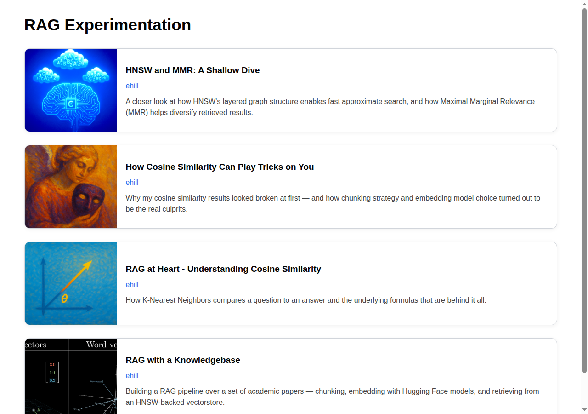

# RAG Experimentation

[https://ehill.github.io/blog/](https://ehill.github.io/blog/)

## Abstract

This repository serves as an informal research notebook documenting a series of experiments undertaken while studying Retrieval-Augmented Generation (RAG) systems. Each entry records an empirical inquiry into a specific component of the retrieval pipeline (chunking strategy, embedding model behavior, approximate nearest-neighbor search, and result diversification), with observations drawn from direct experimentation rather than secondary sources. The intent is not to present a finished system, but to trace the reasoning, missteps, and evolving understanding that accompany learning RAG from first principles.

## Contents

- **[Understanding Cosine Similarity](https://ehill.github.io/blog/posts/RAG-at-heart.html)**: an introduction to cosine similarity as the basis for comparing a query against candidate passages in a vector space.
- **[How Cosine Similarity Can Play Tricks on You](https://ehill.github.io/blog/posts/how-cosine-similarity-can-play-tricks-on-you.html)**: a comparative evaluation of chunking and retrieval strategies (fixed-size cosine retrieval, HNSW with MMR, and hybrid BM25/dense retrieval with reranking) against a common test corpus, examining why perceived retrieval failures were often attributable to chunking and embedding choices rather than the similarity metric itself.
- **[HNSW and MMR: A Shallow Dive](https://ehill.github.io/blog/posts/Math-Hour-with-HNSW-and-MMR.html)**: an examination of Hierarchical Navigable Small World (HNSW) graph indexing and Maximal Marginal Relevance (MMR) as mechanisms for efficient approximate search and diversified result retrieval.
- **[RAG with a Knowledgebase](https://ehill.github.io/blog/posts/RAG-with-a-knowledgebase.html)** *(work in progress)*: a proposed pipeline for retrieval over a corpus of academic papers, currently in the design stage.

## Notes

The site is built as a set of static, hand-authored HTML pages and deployed via GitHub Actions to GitHub Pages. Supporting reference material and captured evaluation output are included under `blog-files/` and `blog-images/`.

## License

Distributed under the terms of the [Apache License 2.0](./LICENSE).
